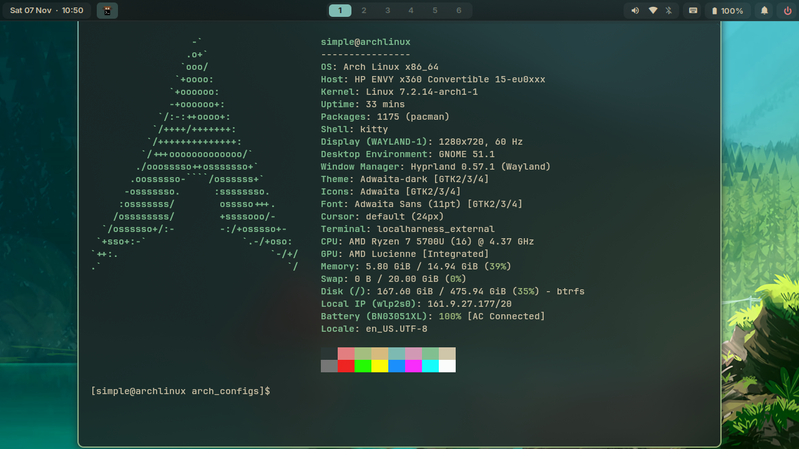
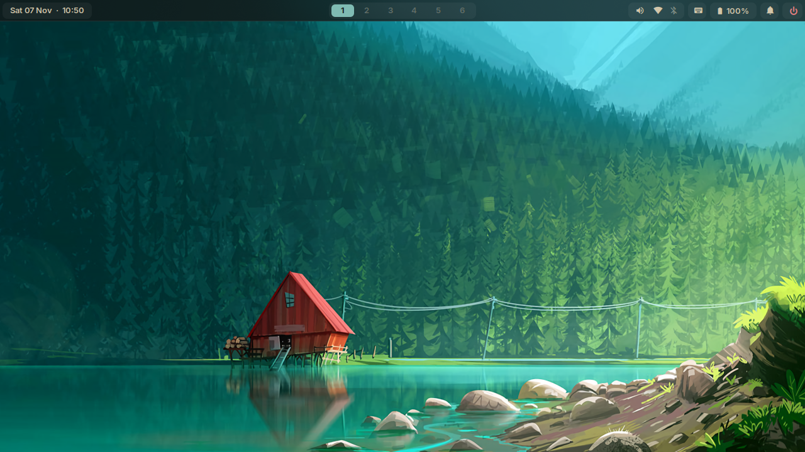

# Arch Hyprland Dotfiles

Personal Arch Linux configuration using Hyprland with Lua modules, Waybar with GTK Layer Shell menus, and an Everforest Dark theme palette.

## Screenshots

### Desktop with Fastfetch


### Clean Desktop


## Overview

- **Window Manager**: Hyprland 0.57+ with modular Lua configuration (`hypr/modules/`). Windows float by default with centered placement and `hyprbars` window controls.
- **Top Bar**: Waybar with flush layout, workspace pager, system tray, audio slider, and battery status.
- **Layer Shell Menus**: Custom GTK Layer Shell menus (`waybar/menus/`) for audio outputs/inputs, Wi-Fi scanning and authentication, Bluetooth devices, and power controls.
- **App Launcher**: `nwg-drawer` and `rofi` with Everforest theme.
- **Dock**: `nwg-dock-hyprland` pinned to the bottom.
- **Notification Daemon**: SwayNC (`swaync/`) with notification center toggle.
- **Terminal**: Kitty with JetBrainsMono Nerd Font and Everforest colors.
- **Lock Screen**: Hyprlock (`hypr/hyprlock.conf`) with multi-user SDDM switching.
- **Touch / Tablet**: Integrated onboard on-screen keyboard toggle on Waybar.

## Keybindings

### Applications & System

| Keybinding | Action |
| :--- | :--- |
| `Super` + `Return` / `Ctrl` + `Alt` + `T` | Launch terminal (Kitty) |
| `Super` + `Space` / `Super` + `D` | Open application drawer (`nwg-drawer`) |
| `Super` + `E` | Open file manager (Nautilus) |
| `Super` + `I` | Open Settings (`gnome-control-center`) |
| `Ctrl` + `Shift` + `Esc` | Open task manager (`htop`) |
| `Super` + `Esc` | Open power menu |
| `Super` + `L` | Lock screen (`hyprlock`) |
| `Ctrl` + `Alt` + `S` / `Ctrl` + `Alt` + `Del` | Switch user to SDDM greeter (works from lock screen) |

### Window Management

| Keybinding | Action |
| :--- | :--- |
| `Super` + `Q` / `Alt` + `F4` | Close active window |
| `Super` + `F` / `F11` | Toggle fullscreen space |
| `Super` + `V` | Toggle floating mode |
| `Super` + `M` / `Super` + `H` | Minimize / hide window to scratchpad |
| `Super` + `Shift` + `M` | Toggle scratchpad overlay |
| `F3` / `Super` + `Up` | Mission Control / Spaces overview |
| `Alt` + `Tab` / `Super` + `Tab` | Cycle next window and bring to top |
| `Alt` + `Shift` + `Tab` | Cycle previous window |
| `Super` + `Left` / `Right` / `Down` | Move focus directional |
| `Super` + `Shift` + `Arrows` | Swap window position directional |
| `Super` + `LMB Drag` | Move floating window |
| `Super` + `RMB Drag` | Resize floating window |

### Workspaces & Navigation

| Keybinding | Action |
| :--- | :--- |
| `Super` + `1` .. `9`, `0` | Switch to workspace 1–10 |
| `Super` + `Shift` + `1` .. `9`, `0` | Move active window to workspace 1–10 |
| `Super` + `[` / `]` | Previous / next workspace |
| `Super` + `Ctrl` + `Left` / `Right` | Previous / next workspace |
| `Super` + `Scroll` | Cycle workspaces |

### Media & Hardware

| Keybinding | Action |
| :--- | :--- |
| `Print` / `Super` + `Shift` + `S` | Area screenshot to clipboard (`grim` + `slurp`) |
| `XF86AudioRaiseVolume` | Volume +5% (`wpctl`) |
| `XF86AudioLowerVolume` | Volume -5% (`wpctl`) |
| `XF86AudioMute` | Toggle output mute (`wpctl`) |
| `XF86AudioMicMute` | Toggle microphone mute (`wpctl`) |
| `XF86MonBrightnessUp` | Brightness +5% (`brightnessctl`) |
| `XF86MonBrightnessDown` | Brightness -5% (`brightnessctl`) |

## Dependencies

### Core Packages (Arch Linux)

```bash
# Compositor, bar, notifications, and menus
sudo pacman -S hyprland waybar swaync rofi kitty grim slurp swaybg polkit-gnome

# Audio, networking, and Bluetooth
sudo pacman -S pipewire wireplumber pavucontrol networkmanager network-manager-applet bluez bluez-utils blueman

# Power management and hardware controls
sudo pacman -S power-profiles-daemon onboard brightnessctl

# GTK Layer Shell & Python bindings (used by Waybar popups and scripts)
sudo pacman -S gtk-layer-shell python-gobject

# Fonts
sudo pacman -S ttf-jetbrains-mono-nerd noto-fonts-emoji inter-font
```

### AUR Packages

```bash
yay -S nwg-drawer nwg-dock-hyprland
```

## Installation & Setup

1. Back up existing configuration files:
   ```bash
   cp -r ~/.config ~/.config.backup
   ```

2. Clone this repository into `~/.config`:
   ```bash
   git clone https://github.com/Abdullahon2006/arch_configs.git ~/.config
   ```

3. Set your wallpaper:
   Place an image at `~/Pictures/wallpaper.jpg`, or update the path in `hypr/modules/autostart.lua` and `hypr/hyprlock.conf`.

4. Reload configuration:
   - Hyprland: `hyprctl reload`
   - Waybar: `killall -SIGUSR2 waybar`
