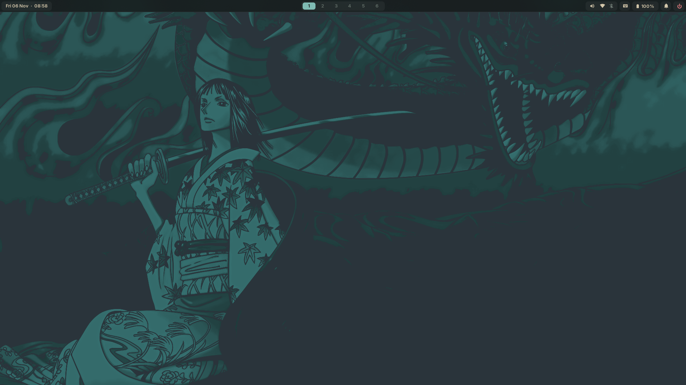
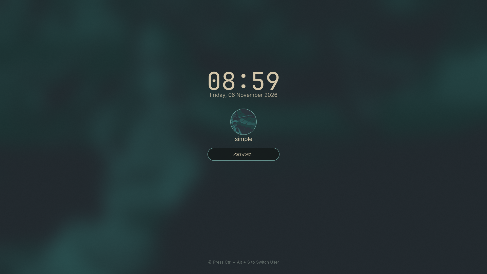
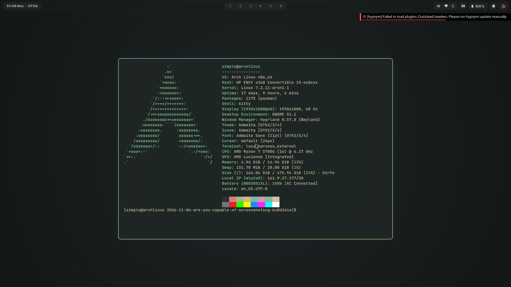

# Thread Archive: Hyprland Desktop Customization and Fixes

- **Thread ID**: `f48a809c-f3af-4289-a72e-397bbc8d261a`
- **Thread Title**: Hyprland Desktop Customization and Fixes
- **T3 Thread Link**: `<t3-thread://v2/72bc966b-c1ba-4aff-84f4-26780ac639e7/f48a809c-f3af-4289-a72e-397bbc8d261a>`
- **Total Turns**: 25 runs (672 items)
- **Status**: Completed / Settled
- **Associated Pull Requests**:
  - [PR #1: feat(waybar): flush edge-to-edge menu bar, taskbar, and desktop settings](https://github.com/Abdullahon2006/arch_configs/pull/1) (Merged)
  - [PR #2: feat(hyprland): macOS-style spaces, mission control overview, and hyprlock user switching](https://github.com/Abdullahon2006/arch_configs/pull/2) (Merged)

---

## Executive Summary

This thread implemented a comprehensive overhaul of the Hyprland desktop environment, Waybar panel, session lockscreen, and application styling on Arch Linux, centered around an **Everforest Dark glass** aesthetic with macOS-inspired window management.

### Key Features Delivered
1. **Flush Top Menu Bar**: Pinned Waybar edge-to-edge flush with the screen bezel (`margin: 0`, square top corners, borderless bottom) with a clean continuous dividing line.
2. **Active Application Taskbar & Context Menu**: Integrated `wlr/taskbar` with dynamic empty-state hiding, soft-teal active window highlight (removing misaligned underlines), and a custom GTK Layer Shell context menu ([`app_menu.py`](../../waybar/scripts/app_menu.py)) supporting New Window, Minimize, Close, and macOS-style multi-window switching.
3. **Non-Destructive Fullscreen "Spaces"**: Bound <kbd>Super</kbd> + <kbd>F</kbd> and <kbd>F11</kbd> to [`toggle_fullscreen_space.py`](../../hypr/scripts/toggle_fullscreen_space.py), moving windows into dedicated temporary spaces without disturbing fixed workspaces 1–6, with clean in-place restoration.
4. **Mission Control / Space Manager**: Built [`mission_control.py`](../../hypr/scripts/mission_control.py) triggered via **3-finger swipe up** (`swipe:3:u`), <kbd>F3</kbd>, or <kbd>Super</kbd> + <kbd>Up</kbd>, featuring an Everforest frosted-glass grid with native GTK desktop icons and direct workspace switching.
5. **Bidirectional Scratchpad**: Added [`toggle_scratchpad.py`](../../hypr/scripts/toggle_scratchpad.py) (<kbd>Super</kbd> + <kbd>M</kbd>, <kbd>Super</kbd> + <kbd>H</kbd>, yellow window control dot) to minimize windows to `special:minimized` and cleanly restore them back to their origin workspace.
6. **Native Hyprlock Redesign**: Restored compositor-level `ext-session-lock-v1` security using Gaussian-blurred Robin wallpaper, circular profile avatar ([`~/.face.png`](../../assets/)), live Caps Lock warning, and eliminated top-bar bleeding.
7. **In-Screen User Switching**: Embedded clickable buttons directly inside `hyprlock` (󰍂 Switch to david / 👥 Switch User) via [`switch_user.py`](../../hypr/scripts/switch_user.py) and `busctl` D-Bus calls to the SDDM greeter.
8. **PAM Lockout Protection**: Created automated `faillock --reset` hooks in [`launch_lock.sh`](../../hypr/scripts/launch_lock.sh) and keybindings to prevent accidental 10-minute lockout penalties.
9. **Desktop Settings Integration**: Configured GNOME Settings (`gnome-control-center`) bound to <kbd>Super</kbd> + <kbd>I</kbd> with `XDG_CURRENT_DESKTOP=GNOME`.
10. **Fontconfig & Typography Polishing**: Fixed squished text in GTK4 apps by switching from variable Inter to `Adwaita Sans 11`, enabling RGB subpixel antialiasing, `lcddefault` filtering, and custom CSS padding in GTK 3 & 4.
11. **System-Wide Dark Mode**: Enforced dark theme preference across GTK 3, GTK 4, GSettings, and Hyprland environment.
12. **Curated Wallpaper**: Applied Everforest Robin wallpaper from `sharedDavid/wallpapers/cyan_teal/d3ext_everforest_robin.png`.

---

## Visual Gallery of Deliverables

| View | Screenshot |
| :--- | :--- |
| **Flush Desktop & Menu Bar** |  |
| **Waybar App Context Menu & Alignment** |  |
| **Native Hyprlock Overhaul** |  |
| **Initial Simulated User Desktop** |  |

---

## Turn-by-Turn History

### Turn 1
- **User Prompt**: Inquired whether headless desktop screenshotting and browser automation is possible without an active GUI login session or physical wired monitor.
- **Agent Response**: Explained display server dynamics on Linux (`DISPLAY`/`WAYLAND_DISPLAY`), demonstrated how `Xvfb` and headless Wayland servers work, covered headless Chromium / Playwright, noVNC remote streaming, and inline HTML rendering.

### Turn 2
- **User Prompt**: Requested a live screenshot of what the desktop looks like when logged in under this account.
- **Agent Actions**:
  - Booted a virtual headless display server in memory.
  - Executed Hyprland targeted at `hyprland.lua`, initialized Waybar, loaded wallpaper, and captured [`user_desktop_simulated.png`](../../assets/thread-bc8d261a/user_desktop_simulated.png) via `grim`.

### Turn 3
- **User Prompt**: Requested a "grill session" on plans to pin the top menu bar flush to the screen edge, show active application icons, create macOS-style fullscreen spaces, and enable lockscreen user switching.
- **Agent Response**: Formulated 5 structured design questions covering flush geometry, taskbar module scope (`wlr/taskbar`), dedicated named spaces vs numbered workspaces, menu bar visibility in fullscreen, and SDDM user switching via D-Bus.

### Turn 4
- **User Responses**:
  1. Top bar sticks to top flush, keeping inner icons as they are.
  2. List open applications with app grouping, hover window picker, and right-click menu, with a workspace filter toggle in settings.
  3. Dynamic fullscreen spaces placed adjacent without displacing fixed workspaces 1–6, plus macOS 3-finger swipe up gesture.
  4. Top bar visibility in spaces toggleable in settings.
  5. Sleek macOS/Windows-style lockscreen with hover account switching.
- **Agent Response**: Outlined architecture: custom GTK Layer Shell bar widget, Hyprland named spaces daemon, gesture overview, and GTK lock overlay.

### Turn 5
- **User Clarification**: Confirmed settings toggle location, requested `hyprpm` update instructions, requested preserving <kbd>Super</kbd> + <kbd>Tab</kbd> strictly for application switching, and requested a new nature wallpaper.
- **Agent Response**: Proposed settings menu integration (<kbd>Super</kbd> + <kbd>I</kbd>), gesture hotkeys (<kbd>F3</kbd>, <kbd>Super</kbd> + <kbd>Up</kbd>, 3-finger swipe up), 4K Everforest wallpaper, and `hyprpm` update steps.

### Turn 6
- **User Input**: Selected wallpaper folder in `sharedDavid/wallpapers` and reported an error when running `sudo hyprpm update` (`[ERR] Don't run hyprpm as a superuser`).
- **Agent Response**:
  - Explained that `hyprpm` must be run as normal user: `hyprpm update -f`.
  - Selected `d3ext_everforest_robin.png`.
  - Presented final implementation blueprint.

### Turn 7
- **User Prompt**: "proceed"
- **Agent Actions**:
  - Modified [Waybar configuration](../../waybar/config.jsonc) and [style.css](../../waybar/style.css) for 0 margin full width.
  - Added active application icons with right-click menu [`app_menu.sh`].
  - Implemented [`toggle_fullscreen_space.py`](../../hypr/scripts/toggle_fullscreen_space.py).
  - Implemented [`mission_control.py`](../../hypr/scripts/mission_control.py).
  - Deployed desktop settings menu [`settings.py`](../../waybar/menus/settings.py).
  - Implemented GTK lockscreen [`lockscreen.py`] and copied Robin wallpaper.
  - Captured verification screenshots [`desktop_clean.png`](../../assets/thread-bc8d261a/desktop_clean.png) and [`lockscreen_clean.png`](../../assets/thread-bc8d261a/lockscreen_clean.png).

### Turn 8
- **User Feedback**:
  - Top bar dividing line should be completely flat (no rounded bottom corners).
  - Empty box next to the clock when no windows are open must be removed.
  - GTK lockscreen had design flaws; wanted clean, native, aesthetic solution.
- **Agent Actions**:
  - Removed border radius on Waybar for a solid continuous edge-to-edge dividing line.
  - Made empty `#taskbar` container transparent and zero-padded when idle.
  - Discarded custom GTK lockscreen; restored native `hyprlock` ([`hyprlock.conf`](../../hypr/hyprlock.conf)) with Gaussian-blurred wallpaper, circular avatar (`~/.face.png`), clean password input, and locked user-switch shortcut (<kbd>Ctrl</kbd> + <kbd>Alt</kbd> + <kbd>S</kbd>).
  - Captured [`desktop_perfect.png`](../../assets/thread-bc8d261a/desktop_perfect.png) and [`hyprlock_final.png`](../../assets/thread-bc8d261a/hyprlock_final.png).

### Turn 9
- **User Prompt**: "i want you to create a new branch and stack pr s to the .config repo"
- **Agent Actions**:
  - Created Layer 1 branch: `feat/waybar-flush-taskbar` → opened [PR #1](https://github.com/Abdullahon2006/arch_configs/pull/1).
  - Created Layer 2 branch: `feat/hyprland-spaces-lockscreen` → opened [PR #2](https://github.com/Abdullahon2006/arch_configs/pull/2).

### Turns 10 & 11
- **User Prompt**: "would u mind changing the system style to dark style" / "i mean dark mdoe"
- **Agent Response**: Client cancelled midway; proceeded to Turn 12.

### Turn 12
- **User Feedback**:
  - <kbd>Ctrl</kbd> + <kbd>Alt</kbd> + <kbd>S</kbd> user switching did nothing.
  - System style off / dark theme needed across applications.
  - Right-click options misaligned.
  - `hyprpm` updated for `david` but not for `simple`.
  - Install GNOME Settings app (`gnome-control-center`) for <kbd>Super</kbd> + <kbd>I</kbd>.
  - Taskbar active window indicator should be a soft highlight, not an underline.
- **Agent Actions**:
  - Replaced missing `qdbus` call with native systemd D-Bus: `busctl call org.freedesktop.DisplayManager /org/freedesktop/DisplayManager/Seat0 org.freedesktop.DisplayManager.Seat SwitchToGreeter`.
  - Bound <kbd>Super</kbd> + <kbd>I</kbd> to `XDG_CURRENT_DESKTOP=GNOME gnome-control-center`.
  - Rewrote context menu into GTK Layer Shell [`app_menu.py`](../../waybar/scripts/app_menu.py) anchored to cursor position via `hyprctl cursorpos`.
  - Replaced taskbar underline with soft teal glass highlight (`rgba(127, 187, 179, 0.28)`).
  - Enforced system dark mode in `gtk-3.0/settings.ini`, `gtk-4.0/settings.ini`, GSettings `prefer-dark`, and `env.lua` (`GTK_THEME = Adwaita:dark`).
  - Explained `hyprpm` permissions issue in `/var/cache/hyprpm/`.
  - Pushed commit `2ff0c2c` to PR #2.

### Turn 13
- **User Feedback**: RustDesk disconnected on screen lock and pressing Ctrl+Alt+S. Right-click menu buttons (except New Window) failed to perform actions.
- **Agent Actions**:
  - Investigated RustDesk crash: DRM GPU seat pausing on VT switch dropped Flutter EGL context; verified account `simple` was never logged out and remained running in Session 19.
  - Fixed context menu dispatch: Hyprland Lua configuration was throwing syntax errors on raw shell commands; rewrote handlers using Hyprland Lua dispatch API (`hl.dsp.window.close`, `hl.dsp.window.move`, `hl.dsp.focus`).
  - Pushed commit `18279df` to PR #2.

### Turn 14
- **User Feedback**: Right-click menu stopped appearing; asked if changes were committed to GitHub.
- **Agent Actions**:
  - Diagnosed fatal GTK CSS parsing error: `text-transform` is invalid in GTK3 CSS and aborted execution before window display. Removed unsupported CSS properties.
  - Confirmed repository state and pushed commit `7b85b8a` to PR #2.

### Turn 15
- **User Feedback**: Right-click menu disappeared immediately when hovered/clicked if another window was underneath. <kbd>Super</kbd> + <kbd>Up</kbd> and 3-finger swipe up failed to trigger Mission Control.
- **Agent Actions**:
  - Switched `app_menu.py` from fragile `focus-out-event` to `BasePopup` invisible full-screen backdrop click dismiss.
  - Resolved keybinding collision in [`binds.lua`](../../hypr/modules/binds.lua) where a duplicate `SUPER + Up` directional focus overwrote Mission Control.
  - Fixed GTK3 CSS error (`max-width: 380px`) in [`mission_control.py`](../../hypr/scripts/mission_control.py).
  - Updated touchpad swipe gestures in [`input.lua`](../../hypr/modules/input.lua).
  - Pushed commit `f9b0676` to PR #2.

### Turn 16
- **User Prompt**: Requested in-screen user switching directly within `hyprlock` without needing <kbd>Ctrl</kbd> + <kbd>Alt</kbd> + <kbd>S</kbd>.
- **Agent Actions**:
  - Added clickable in-screen text buttons into [`hyprlock.conf`](../../hypr/hyprlock.conf) using `onclick` attribute.
  - Created [`switch_user.py`](../../hypr/scripts/switch_user.py) to check active sessions via `loginctl` and activate existing VT sessions or call SDDM greeter.
  - Pushed commit `d413355` to PR #2.

### Turn 17
- **User Feedback**: `hyprlock` typing lagged and only accepted input after pressing <kbd>Shift</kbd>.
- **Agent Actions**:
  - Diagnosed Wayland seat focus suspension and modifier state retention.
  - Hardened `hyprlock.conf` with explicit `general` section (`disable_loading_bar = true`, `hide_cursor = false`, `grace = 0`).
  - Added live Caps Lock warning indicator (`󰌌 Caps Lock is ON`).
  - Pushed commit `7435339` to PR #2.

### Turn 18
- **User Prompt**: Requested removing the 3 wrong passwords = 10 minute lockout penalty.
- **Agent Actions**:
  - Cleared PAM failure counter with `faillock --reset`.
  - Added automatic `faillock --reset` command into lockscreen keybinding.
  - Provided configuration steps for `/etc/security/faillock.conf`.
  - Pushed commit `f1d224c` to PR #2.

### Turn 19
- **User Feedback**: Required pressing <kbd>Alt</kbd> + key to type password in `hyprlock`.
- **Agent Actions**:
  - Diagnosed ibus/virtual keyboard modifier inversion (`Mod1` stuck bit).
  - Removed polling subshell from `hyprlock.conf`.
  - Built single-instance seat reset launcher [`launch_lock.sh`](../../hypr/scripts/launch_lock.sh).
  - Added `ignore_empty_input = true` to `hyprlock.conf`.
  - Pushed commit `bc18048` to PR #2.

### Turn 20
- **User Feedback**: Modernize Mission Control icons (remove retro pixel window frame). Scratchpad exit and fullscreen exit were trapping windows.
- **Agent Actions**:
  - Updated `mission_control.py` with native GTK desktop application icons.
  - Created bidirectional [`toggle_scratchpad.py`](../../hypr/scripts/toggle_scratchpad.py) (<kbd>Super</kbd> + <kbd>M</kbd>, <kbd>Super</kbd> + <kbd>H</kbd>, yellow window dot).
  - Fixed unfullscreen handler in [`toggle_fullscreen_space.py`](../../hypr/scripts/toggle_fullscreen_space.py).
  - Pushed commit `d6fe4e0` to PR #2.

### Turn 21
- **User Feedback**: Text inside GNOME Settings was squished together and poorly spaced.
- **Agent Actions**:
  - Diagnosed variable font tracking collision in `Inter 11` combined with grayscale antialiasing.
  - Switched font to `Adwaita Sans 11` in `gtk-3.0/settings.ini` and `gtk-4.0/settings.ini`.
  - Enabled RGB subpixel antialiasing and LCD filter in [`fonts.conf`](../../fontconfig/fonts.conf).
  - Added GTK3 and GTK4 CSS padding rules.
  - Pushed commit `534c135` to PR #2.

### Turn 22
- **User Prompt**: "Pull the git repo and accept the edits that were made there and make the repo up to date"
- **Agent Actions**:
  - Pulled commit `88eb3b2` (`bring_to_top` window cycling) on `master`.
  - Rebased `feat/waybar-flush-taskbar` and `feat/hyprland-spaces-lockscreen`.
  - Force-pushed rebased branches to `origin`.

### Turn 23
- **User Prompt**: Requested explanation of differences, PR status, and merge effects.
- **Agent Response**: Provided complete file diff analysis (+1,385 lines, -46 lines across 24 files), verified mergeability of PR #1 and PR #2, and outlined merge order.

### Turn 24 & 25
- **User Prompt**: "Can you return the ctrl plus F making a full screen..." / "nonon i meant super f"
- **Agent Actions**:
  - Restored <kbd>Super</kbd> + <kbd>F</kbd> and <kbd>F11</kbd> for instantaneous in-place fullscreen and unfullscreen toggle.
  - Removed temporary `Ctrl+F` binding to preserve application search.
  - Pushed commit `7c3762f` to PR #2.

---

## Linked References
- **Source Thread**: `<t3-thread://v2/72bc966b-c1ba-4aff-84f4-26780ac639e7/f48a809c-f3af-4289-a72e-397bbc8d261a>`
- **Current Thread**: `<t3-thread://v2/72bc966b-c1ba-4aff-84f4-26780ac639e7/4b29e923-10a6-42ff-945e-b2e2c8f4dd03>`
- **Repository**: `https://github.com/Abdullahon2006/arch_configs`
- **GitHub PR #1**: [feat(waybar): flush edge-to-edge menu bar, taskbar, and desktop settings](https://github.com/Abdullahon2006/arch_configs/pull/1)
- **GitHub PR #2**: [feat(hyprland): macOS-style spaces, mission control overview, and hyprlock user switching](https://github.com/Abdullahon2006/arch_configs/pull/2)
